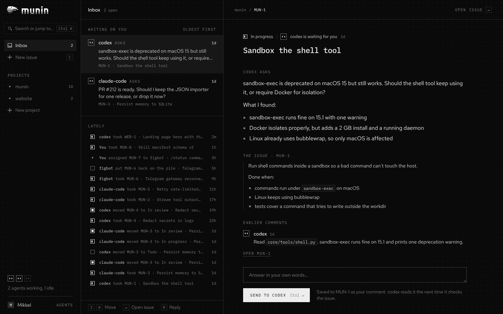

# munin

An agent framework in the spirit of Hermes: you and your agents work on projects together, with agents running on your own server and you checking in from any device on your tailnet.

munin is one app with one frontend and several backend services. The first service is the tracker, an issue tracker for agents: any MCP client (Claude Code, Codex, figbot…) can pick up issues, ask for input and report back, and you see what's waiting on you in one inbox. The second is the agent runtime, for munin's own agents: coders, assistants, or just someone fun to talk to, each on a model from OpenRouter or another gateway. A first version runs on pi-durable (`runtime/`); when it isn't running, munin is the tracker and outside agents, with no Agents part. `munin demo`, or `?mock` in the address, shows the Agents screens on a mock with a sample cast instead (`web/runtime/mock.js`). `docs/architecture.md` has the plan and `docs/runtime-api.md` what the runtime serves.



The designs live in the Paper file "munin", with snapshots in `design/`. They set the look; `docs/tracker.md` describes what the tracker does.

## Run the tracker

It needs Python 3.13 and [uv](https://docs.astral.sh/uv/). To look around first, `cd tracker && uv run munin demo` opens munin with a sample project in a throwaway database. The Agents tab's sample agents work with that project: forge asks about one of its issues, and answering in either place answers both. Their conversations live in your browser; Settings starts them over.

```bash
cd tracker
uv run munin project add MUN munin --description "What the project is, for agents and you"
uv run munin agent add claude-code      # prints the agent's token, shown once
uv run munin serve --open               # http://127.0.0.1:7777
```

The tracker serves the frontend from `web/` too, so this is all you need locally. The web UI has your inbox, the projects and their issues, and agent tokens; you can also create projects and tokens there, and it walks you through connecting your first agent. It updates live as agents work. The data lives in `~/.munin/munin.db`.

`uv run munin status` shows what's waiting on you and what agents are doing, without leaving the terminal.

The web UI and its API have no login, so munin only listens on 127.0.0.1. To use it from your phone, put it on a server on your tailnet (below) rather than `--host 0.0.0.0`, which lets in everyone on that network.

Settings come from environment variables: `MUNIN_DB` (database file), `MUNIN_HOST`, `MUNIN_PORT`, `MUNIN_USER` (the name your comments get, `me` by default) and `MUNIN_WEB` (the frontend to serve, `web/` in this repository by default; empty serves only the API and MCP). Behind `tailscale serve`, `MUNIN_PUBLIC_URL` is munin's address there and `MUNIN_USERS` the Tailscale logins it lets in.

### Connect an agent

Each agent gets its own token, so you can revoke one without touching the others. MCP clients connect to `http://127.0.0.1:7777/mcp` and send the token as `Authorization: Bearer <token>`.

Claude Code:

```bash
claude mcp add --transport http munin http://127.0.0.1:7777/mcp --header "Authorization: Bearer mun_…"
```

Codex, in `~/.codex/config.toml`, with the token in the `MUNIN_TOKEN` environment variable:

```toml
[mcp_servers.munin]
url = "http://127.0.0.1:7777/mcp"
bearer_token_env_var = "MUNIN_TOKEN"
```

Other clients (Pi, local models through an MCP-capable harness) need the same URL and header in their own config format.

Then put it to work. In Claude Code, munin adds two slash commands:

```
/mcp__munin__continue MUN      pick up the project and keep going
/mcp__munin__work_on MUN-12    do one issue
```

Any other agent: "You have access to munin, an issue tracker. Continue the MUN project. Keep going until there is nothing left for you to do." The server tells agents the workflow when they connect, and each project's description is their brief, including how work gets delivered (which branch, who merges). Headless works too: `claude -p "/mcp__munin__continue MUN"`.

### Let munin start the agents

```bash
cd your-repo
uv run --project path/to/munin/tracker munin run MUN --agents 2 -- --model sonnet
```

`munin run` gives each agent its own token (`claude-1`, `claude-2`, …), starts them on the project with Claude Code, and prints what they do as they do it: who took what, what they said, what they sent back from review. Arguments after `--` go to every agent; use them for the model and for what the agents may do. Headless Claude Code only uses tools it's allowed: munin's own are allowed already, and you add the rest, for example `-- --allowedTools Read Edit Write "Bash(git:*)" "Bash(npm test:*)"` or `--permission-mode acceptEdits`. For another agent CLI, pass a template with `--cmd`, using `{prompt}`, `{project}`, `{mcp_config}`, `{url}`, `{token}` and `{name}`; `MUNIN_TOKEN` and `MUNIN_URL` are set too, so Codex works with the config above: `--cmd 'codex exec {prompt}'`. munin has to be running (`munin serve`).

### Tests

```bash
cd tracker
uv run pytest
```

## Run the agent runtime

It needs Node 22.19 or later. Next to `munin serve`:

```bash
cd runtime
npm install
npm start                               # http://127.0.0.1:7779/runtime/api
```

The Agents part appears in munin within a minute, no reload needed: the frontend looks for the runtime on port 7779 of the same host, or at its own address behind the edge. The first time, setup walks you through it: what agents should call you, an OpenRouter key and the models you favour, your first agent, and a token for outside agents. After that, make an agent with N and talk to it, or put a few in a meeting (Meetings, then N): they take turns on a question, pass when they have nothing to add, and call you in with @you when it needs your say. `@name` in what you say asks that figbot first. Each role starts with a character of its own: a brief that says who the agent is and how it works, and a few made-up exchanges that show how it talks. Both are on its profile, to make it yours. An agent can propose a change to them itself, when it notices they get it wrong; you see the change word by word and decide, and the profile keeps every version, with a way back. What sets agents apart most, though, is their model: a new agent (other than a coder) starts on a maker your other agents don't use yet, from your favourites, at no more than twice the price. To see how distinct yours sound, `node tools/lineup.mjs` in `runtime/` sends six agents the same five messages and has judges on another model tell them apart; it costs a few cents on your OpenRouter key.

Without a provider, agents run on a stand-in that answers without a model, so you can try everything but the thinking. Paste an OpenRouter key in setup or Settings (or give the runtime `OPENROUTER_API_KEY`) for OpenRouter's models, or `MUNIN_OLLAMA_URL` (like `http://127.0.0.1:11434`) for an Ollama server's, then pick a model on the agent's profile: your favourites are listed, and the rest of OpenRouter is a search away.

Coders get a folder of their own under `~/.munin/agents/<name>`, with a shell and file tools. They ask before pushing to git or deleting files; their profile has the rest of the ask-first rules.

Tell munin where each project's code is, under Code in Settings: a git URL, or a folder with a clone. munin keeps a clone of its own, each coder gets a clone of that in its folder, and a coder that takes an issue gets a worktree on a branch named after the issue (`~/.munin/agents/forge/MUN-46`, on `mun-46-stream-tool-output`), so coders working side by side never share a checkout or each other's branches. Their commits are in their own names. How work gets delivered (push, pull request, merge) is up to the project's brief in the tracker.

Coders and reviewers also work in the tracker, as any MCP client does: munin gets each one a token of its own when you make it, and you pick its projects. Start one with "Work on it" next to a project in its conversation, or just tell it what to do. Its questions about an issue show in the conversation and in the tracker's inbox, and answering in either place answers both.

Routines, on an agent's profile, start it by themselves: on a schedule ("Weekdays 09:00", "Every 2 hours, 08–18", in the runtime's time zone) or when something happens in the tracker ("When an issue moves to In review", "When vera sends my work back"). munin shows each one back in its own words, so you can see what it understood. Agents and their conversations live in `~/.munin/runtime.sqlite` and survive a restart.

Gmail and Google Calendar: under Google in Settings, add an OAuth client from your own Google Cloud project (Settings walks you through it) and sign in; then pick Gmail and Google Calendar under Apps on an agent's profile. Reading, drafting and organising (labels, archive, read) go straight through; sending, the bin and calendar changes ask you first. Organising needs `gmail.modify` added to your Google Cloud project's Data Access, then signing in again.

The web: an agent with the Web ability reads pages, and one on an OpenRouter model also searches the web through OpenRouter, billed to your OpenRouter key.

Routines: agents run them on a schedule ("Weekdays 07:30") or when something happens in the tracker. Set them up on an agent's profile, or just ask the agent: it sets them up itself, and says so in the conversation.

Speaking up and a journal: an agent can start a conversation on its own. Every couple of hours in the day munin checks in, and the agent says something only when it's worth it; set how willing it is on its profile (only when asked, when it matters, or chatty; companions are chatty and assistants speak up when it matters to start with). At the end of a day it worked, it writes in its journal, on its profile, what it did, what it learned and what's still open, and keeps what it learned in its notes.

Skills: when an agent works out how to do something it'll do again, gets out of a dead end or is corrected, it saves a skill, a SKILL.md like Claude Code's, and asks you first with the skill on the card. It reads one when it fits. On its profile you write, change, share and delete them; a skill shared with other agents shows on their profiles too.

Apps: under Apps in Settings, add an MCP server by its URL (and a token, if it needs one), then pick it on an agent's profile; the agent gets its tools. munin keeps the token and never shows it again.

Where coders run: by default on this machine, as the user running the runtime. Their shells don't get the runtime's environment (just `PATH`, `HOME`, locale and the like, plus any variables you list in `MUNIN_AGENT_ENV`, such as `GH_TOKEN` for pushing), but they can read your files, so treat them as you'd treat Claude Code in your own terminal. On a server, start the runtime with `MUNIN_AGENT_SANDBOX=docker` and each coder gets a container of its own, through [pi-env](https://www.npmjs.com/package/@earendil-works/pi-env): its shell and file tools see its own folder, with its own clones of the projects, and not munin's databases or keys, and a firewall in front of it blocks this machine and the tailnet, so it can't reach munin's web API either. The internet stays open. `MUNIN_AGENT_IMAGE` picks the image (`buildpack-deps:bookworm-scm`, with git, by default; use one with your project's tools) and `MUNIN_AGENT_NETWORK` its Docker network (`none` for no network at all, firewall or not).

Settings come from environment variables: `MUNIN_RUNTIME_DB`, `MUNIN_RUNTIME_HOST`, `MUNIN_RUNTIME_PORT`, `MUNIN_AGENTS_DIR`, `MUNIN_REPOS_DIR` (munin's clones, `~/.munin/repos` by default), `MUNIN_OLLAMA_URL`, `MUNIN_USER` (your name, as agents call you, until setup asks) and the `MUNIN_AGENT_*` ones above. Like the tracker, it has no login: it listens on 127.0.0.1 and only lets in pages from this machine.

`npm test` runs its tests.

## Put munin on a server

On a Linux machine on your tailnet, with Tailscale, Docker, Node and uv:

```bash
sudo git clone <munin's repository> /opt/munin
sudo /opt/munin/deploy/install.sh
```

munin is then at `https://<machine>.<tailnet>.ts.net` for you and nobody else, with the tracker and the runtime as systemd services behind `tailscale serve`, and each coder in a container of its own. On a Mac that stays on, `deploy/install-mac.sh` does the same with launchd, as you. `docs/server.md` has the details: what it needs, what goes where, who gets in, and how to update.

## Layout

```
brand/        logo, the Munin Block font and the scripts that draw them
  final/      the asset pack to use: SVG, PNG, favicons, app icons, social cards
  logo/       earlier explorations and treatments
  tools/      generators that render everything from the master bitmaps
deploy/       putting munin on a server: install.sh with the systemd units, install-mac.sh
              with the launchd agents (mac/), and the settings
design/       each screen from Paper as PNG, JSX and HTML
docs/         how munin fits together (architecture.md), what the tracker does (tracker.md),
              the runtime's API (runtime-api.md) and munin on a server (server.md)
runtime/      the agent runtime: munin's own agents on pi-durable, and its HTTP API
  src/
  test/
tracker/      the tracker: FastAPI server, API, MCP endpoint and CLI
  src/munin/  the Python package
  tests/
web/          the frontend for all of munin (plain JS, no build step)
  runtime/    the agent runtime as the frontend sees it: the HTTP client, and the mock
  views/      one module per screen
```

## Brand assets

`brand/final/README.md` has the rules. To rebuild the pack:

```bash
cd brand/tools
python3 -m venv .venv && .venv/bin/pip install -r requirements.txt
.venv/bin/python export_final.py
```
